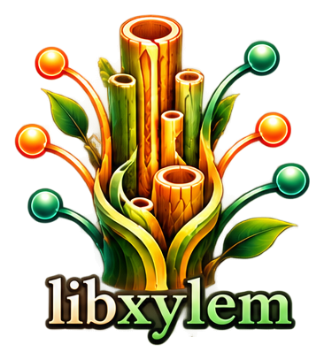

<p align="center">
  
</p>

# @tty-pt/xylem

[](#)
[](#)
[](#)
[](#)
[](#)
[](#)

> Universal Node.js and Browser bindings for **`libxylem`**, the extensible C module bus and dynamic hook dispatch runtime.

---

## 1. Quickstart

```bash
npm install @tty-pt/xylem
```

```typescript
import { XylemBus, areg, call } from "@tty-pt/xylem";

// 1. Register a dynamic hook listener
const unregister = areg("on_event", (payload) => {
  console.log("Received event payload:", payload);
  return { status: "processed" };
});

// 2. Dispatch event across registered listeners
const results = call("on_event", { userId: 101, action: "login" });
console.log("Hook return values:", results);

unregister();
```

---

## 2. JavaScript / TypeScript API Reference

### `XylemBus`
Dynamic module hook and lifecycle event bus.
* `constructor()`: Initializes an isolated event bus.
* `.register(name: string, listener: Function): () => boolean`: Registers hook and returns unsubscribe function. Automatically registers into compiled `xylem.wasm` via `xy_areg()`.
* `.call(name: string, ...args: any[]): any[]`: Dispatches hook sequentially, collecting return values.
* `.has(name: string): boolean`: Checks if any listeners are registered for hook.
* `.unregister(name: string, listener: Function): boolean`: Unregisters specific listener.
* `.list(): string[]`: Lists all registered hook names.

### Standalone Functions
* `areg(name: string, listener: Function): () => boolean`: Registers listener on the global default bus.
* `call(name: string, ...args: any[]): any[]`: Dispatches hook on the global default bus.
* `getXylemWasm(): WebAssembly.Instance`: Returns the WebAssembly instance loaded on the Stele shared-memory substrate.
* `version(): string`: Returns the library semantic version string.

---

## 3. C Development Headers via NPM

```makefile
CFLAGS += -I./node_modules/@tty-pt/xylem/include
LDLIBS += -lxylem
```

---

## 3. Building from Source

```bash
make npm-build    # Compiles native addon and WASM reactor
make npm-test     # Runs verification test suite
```

## License

BSD 2-Clause License. Copyright (c) 2026, tty-pt.
